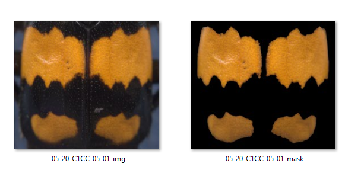
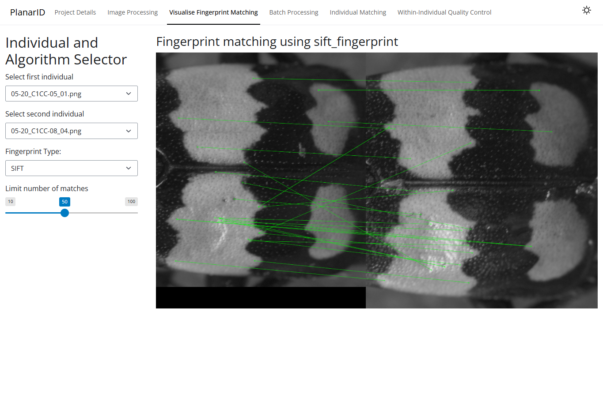

# NicroCam

The design files and datasheets associated with a custom camera trap PCB.

This project builds on the PlanarID python app that uses unique elytral patterns on small beetles to identify individuals in a photographic record. 
PlanarID details are available in the repo (https://github.com/KynanDelaney/PlanarID), and the resulting paper (https://doi.org/10.1002/2688-8319.70190).

  
  <figcaption align="center">Figure 1: An example image from a photographic record, and the resulting "machine-readable"
mask of the identifying pattern.</figcaption>

These images are processed down to a binary mask focussing on the orange patches. The contours and corners of these masks are used to identify individuals using
openCV algorithms.

  
  <figcaption align="center">Figure 2: An example of pattern-matching using elytral features.</figcaption>

----

## Broad goals

The next step is to substantially automate the collection of the photographic record. This requires the following problems to be solved (in no particular order):
  - Images should be taken at distributed camera stations. We need many devices.
  - Image captures should be automatically triggered by detection of an idividual beetle.
    - Option A: Motion detection (perhaps with post-hoc checking of the field of view).
    - Option B: AI/ML in-camera assessment of insects/individuals in the field of view.
    - Option C: Some awesome thing I haven't found yet.
  - Image quality should be good enough for individual identification. This includes night vision challenges, with daytime images less likely.
  - Devices should be battery-powered and function for at least 1 week between charging events.
  - Devices should be waterproof, small, and safe.
    - Devices must survive outdoors.
    - Interference from, and intrusion upon, the public should be minimised.
    - Stakeholder confidence must be maintained.
  - Devices should be CHEAP! We need many devices.
  - Devices should have some means of attracting the target species (*N. vespilloides*) - either bait or UV LEDs.
  - OPTIONAL - Should incorporate a real-time clock and additional sensors for accurate photographic record timestamps and general functioning/ environmental data.

----

## Workshopped solution

The current approach is to design a custom printed circuit board (PCB) that integrates a Pi Pico, Pi Zero, Camera module, and Motion Detector into a tight package that can be mounted in a 3D printed housing or commerically-available waterproof enclosure.
In broad scope, the Pi Pico will be the brains of the board. It will drive a motion-detecting sensor and will, on detecting motion, toggle on the Pi Zero to snap and save images. The Pico will receive power directly from a battery and use its internal voltage divider from the Vsys pin to GPIO29 to monitor battery levels. The battery has built-in over-discharge and current protection, and the pico will act as a software under-voltage lock-out (UVLO) backstop to ensure the camera only turns on when data can safely be written. A handshake between the Pi Zero and Pi Pico GPIO pins will let the Pico know when it is safe to turn off power to the Pi Zero again. 

Around the core Pis, motion sensor, camera, and IR LEDs, there is also some necessary power circuitry: a boost converter to boost the 3.7V battery output to the necessary 5V for the Pi zero, load switch to hard-cut power to the Pi zero to save battery power, photocoupler to keep the Pico informed of the Pi Zero's power state during a camera cycle, mosfets to prevent reverse voltage issues due to human error, capacitors and resistors galore.

The Pi Pico draws milli-Amps of current, and can use the wake-function of a motion sensor to further cut power consumption. The Pi Zero uses 250 - 350 mA, and poses the greatest power challenge. Fast boot times and disabled HDMI, WI-FI, etc will be critical.

### General list of components

Starting with the battery, moving through the power path:

  - Battery: 13400 mAh 1S battery pack (https://shop.pimoroni.com/products/high-capacity-lithium-ion-battery-pack?variant=32012684656723)
  - P-Channel MOSFET - reverse voltage protection for the main PCB.
  - P-Channel MOSFET - power pathing in case a USB is connected to the Pico at the same time as the battery.
  - Pi Pico - the main controller on the PCB.
  - Time-of-Flight sensor - VL35L1/5X to detect motion in a small area/ in a grid and wake the Pi Pico in a low-power mode.
  - Boost Converter - TPS61232 converts 2.3V - 5.5V to 5V for the Pi Zero. 
  - Load Switch - TPS22918 is a back-up switch controlled by the Pico to hard-cut power to the Pi Zero.
  - Pi Zero - an overkill driver for a camera module and basic sensor readings (optional)
  - Pi Camera V2 NOIR - an 8 megapixel camera module based on the Sony IMX219 for high-quality low-light/ night-vision photogrpahy.
  - 850 nm LEDs to illuminate the fixed platform below the plane of the camera.
  - 11 capacitors and 9 resistors required by the ICs and LEDs.

Things that need figuring out:
  - An RTC with battery backup that correctly timestamps images.
  - Temperature, pressure, and humidity sensors. Either for safety monitoring of prototypes to identify problems before failures, or for environmental data collection.
  - Solar power - the current design aims to have an efficient power budget, top-ups from solar power would help a lot but increase complexity greatly.

----

## Project details

### Project schematic

  
  <figcaption align="center">Figure 3: The working schematic for the PCB, subject o review. </figcaption>

### Project Gerber layout

  
  <figcaption align="center">Figure 4: Full, top-down view of Gerber file for proposed PCB. </figcaption>

  
  <figcaption align="center">Figure 5: Top and bottom trace layer of proposed PCB. </figcaption>

### Project BoM

| Quantity | Comment | Designator | Footprint | Value | Manufacturer Part |
| --- | --- | --- | --- | --- | --- |
| 5 | 22uF | C1,C3,C4,C5,C11 | C0805 | 22uF | CL21A226MAQNNNE |
| 1 | 10nF | C2 | C0603 | 10nF | CC0603KRX7R9BB103 |
| 1 | 1uF | C6 | C0805 | 1uF | CL21B105KBFNNNE |
| 1 | 1nF | C7 | C0805 | 1nF | FM21X102K501PXG |
| 2 | 100nF | C8,C10 | C0805 | 100nF | FCC0805B104K500DT |
| 1 | 10uF | C9 | C0805 | 10uF | CL21A106KAYNNNE |
| 1 | B2B-PH-K-S | CN1 | CONN-TH_B2B-PH-K-S | | B2B-PH-K-S |
| 1 | Raspberry Pi Zero 2W with Header | H1 | Raspberry Pi Zero 2W Reverse | | |
| 1 | Raspberry Pi Pico 2 WH | H2 | Raspberry Pi Pico 2 WH_Not_TP4_TP5 | | Raspberry Pi Pico 2 WH |
| 1 | TMP36GT9 | H3 | TO-92-3_L4.2-W1.5-P1.27 | | TMP36GT9 |
| 1 | VL53L1X | H4 | VL53L1_Ail | | |
| 1 | HDR-M_2.54_1x12P | H5 | HDR-TH_12P-P2.54-V-M | | |
| 1 | Raspberry Pi Camera Module v2 | H-CAM | RASPBERRY PI CAMERA MODULE V2 | | |
| 1 | 1uH | L1 | IND-SMD_L4.0-W4.0_XFL4020-102MEB | 1uH | XFL4020-102MEC |
| 2 | LED_TH-R_5mm | LED1,LED2 | LED-TH_BD5.8-P2.54-FD | | |
| 2 | SSM3J338R,LF | Q1,Q2 | SOT-23F_L2.9-W1.8-P0.95-LS2.4-BR | | SSM3J338R,LF |
| 4 | 10kΩ | R1,R2,R4,R9 | R0805 | 10kΩ | 0805W8F1002T5E |
| 1 | 100kΩ | R3 | R0805 | 100kΩ | 0805W8F1003T5E |
| 1 | 1kΩ | R5 | R0805 | 1kΩ | 0805W8F1001T5E |
| 2 | 140Ω | R6,R7 | R1206 | 140Ω | FRC1206F1400TS |
| 1 | 240Ω | R8 | R0603 | 240Ω | RC0603FR-07240RL |
| 1 | TPS61232DRCT | U1 | VSON-10_L3.0-W3.0-P0.50-TL-EP-TPS61232DRCR | | TPS61232DRCT |
| 1 | TPS22918DBVT | U2 | SOT-23-6_L2.9-W1.6-P0.95-LS2.8-BR | | TPS22918DBVT |
| 1 | TL817 | U3 | SOP-4_L6.5-W4.6-P2.54-LS10.3-TL | | TL817 |
----

### 3D Render of PCB

  
  <figcaption align="center">Figure 6: 3D render of proposed PCB, for a sense of scale and layout. </figcaption>

## Developing thoughts

The board is currently being designed on the Pi platform, making use of a high-quality camera module with great low-light performance. This necessarily entails a trade-off in battery life, being consumed to maximise quality. An alternative platform could be based on the ESP-32 P4. The P4 is a high-power ESP-32 with a similar camera connector to the Pi Zero, but would be paired with an OV5647 5 mp module. This board has a higher draw of current but could cycle on, capture images, and shut down about 5x faster than the Pi Zero. Worse image quality, faster fuctioning, less power consumed - drastically increasing battery life. This alternate board design would replace the boost converter with a TPS63021 buck-boost converter to drive 3.3V to the P4 power pin from the 3V - 4.2V battery but otherwise we would try to minimise differences in the main components. The P4 also has built-in ADC GPIO pins, expanding the possible range of sensors that could be coupled to the image-collection loop.

